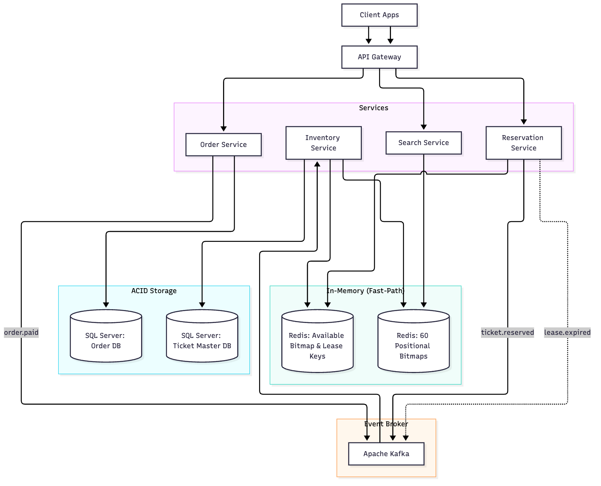
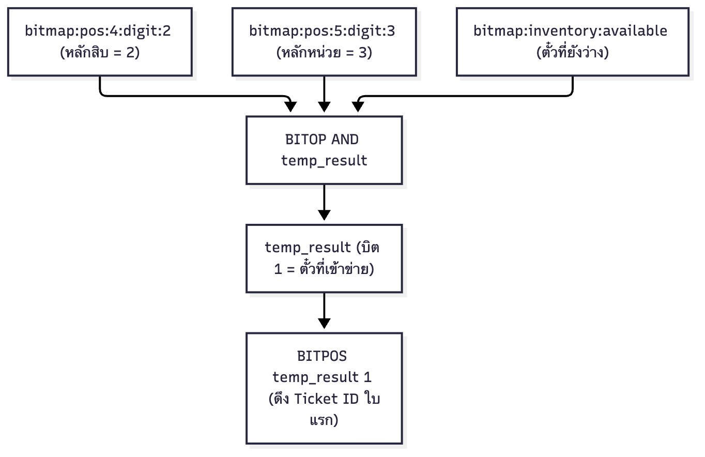
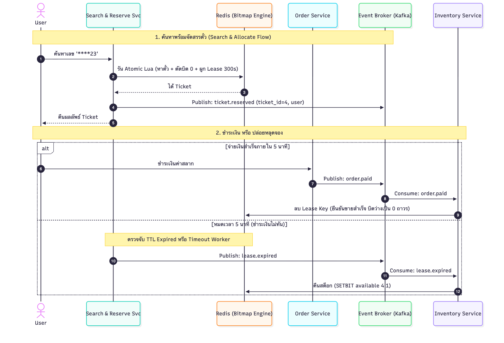

# Lottery Ticket Search System Design

ออกแบบระบบค้นหาและจัดสรรสลาก 10M tickets รองรับ Search Pattern ผสม Wildcard `*` และแก้ปัญหาแย่งตั๋วซ้ำพร้อมกันด้วย Concurrency Lock

---

## 1. Architecture Overview

แยกงานด้วย **CQRS + Event-Driven** ไม่ให้งาน Search กับงาน Payment แย่ง Resource กัน:

- **Redis**: รับงานค้นหาและล็อกตั๋ว Real-time ด้วย Positional Bitmaps และ Lua Script
- **Apache Kafka**: ส่ง Event แจ้งเตือนสถานะตั๋วแบบ Asynchronous
- **SQL Server**: เก็บข้อมูล Master Data, Orders และ Transaction ที่ต้องการ ACID

---

## 2. Data Structure & Pattern Matching

### โครงสร้าง Positional Bitmap: 60 แถว และ 1 สต็อกว่าง

ถ้าใช้ SQL `LIKE '%23'` กับ 10 ล้านแถวจะช้ามาก จึงใช้ Positional Bitmap แทน โดยมองเลข 6 หลักเป็น Index 0 ถึง 5 จากซ้ายไปขวา:

- แต่ละหลักมีเลข 0 ถึง 9 รวมเป็น 60 Bitmaps (`bitmap:pos:<index>:digit:<0-9>`)
- มี Available Bitmap อีก 1 ตัวไว้เช็กตั๋วที่ยังว่าง (`bitmap:inventory:available`)

### วิธี Match Pattern ด้วย Bitwise AND

ตัวอย่างค้นหาเลขท้าย `****23`:

1. ข้าม `*` ไป แล้วดึง Bitmap ของหลักที่ระบุเลข
2. รันคำสั่ง: `BITOP AND temp_result bitmap:pos:4:digit:2 bitmap:pos:5:digit:3 bitmap:inventory:available`
3. บิตที่เป็น 1 ใน `temp_result` คือ Ticket ID ที่ตรงเงื่อนไขและว่างพร้อมขายทันที

---

## 3. Concurrency & Result Distribution

### 3.1 Search & Atomic Allocate ตามโจทย์

โจทย์กำหนดว่า: _ห้ามส่งตั๋วใบเดียวกันให้ผู้ใช้หลายคนที่ค้นหา Pattern เดียวกันพร้อมกัน_

ระบบจึงรวบขั้นตอนค้นหาและล็อกสิทธิ์ไว้ใน **Redis Lua Script** เดียวกัน ซึ่งรันแบบ Single-threaded ปราศจาก Race Condition:

1. `BITOP AND` หาตั๋วที่ตรงเงื่อนไขและยังว่าง
2. `BITPOS` ดึง Ticket ID ใบแรกที่เจอ
3. `SETBIT bitmap:inventory:available <id> 0` ตัดตั๋วออกจากสต็อกว่างทันที ณ ตอนค้นหา
4. `SET lease:ticket:<id> <user_id> EX 300` ล็อกสิทธิ์ถือครองไว้ 5 นาที
5. ส่ง Ticket ID ให้ผู้ใช้ และลบ `temp_result` ทิ้งทันที

> ผู้ใช้คนที่ 2 ที่ค้นหาเข้ามาในเสี้ยววินาทีเดียวกัน จะได้ตั๋วใบถัดไปเสมอ ไม่มีทางได้ตั๋วซ้ำกัน

---

### 3.2 Production Practice: Browse vs Claim

ในชีวิตจริง การล็อกตั๋วตั้งแต่ตอนค้นหาเสี่ยงโดน Bot หรือคนกดเล่นกักตั๋วฟรีจนสต็อกหมด แบบ Search DoS

ทางแก้คือแยก 2 จังหวะ:

1. **Browse Flow**: ดึงตั๋วมาแสดงผลเฉยๆ ยังไม่ตัดบิต 0 และสุ่ม Offset หน้า เพื่อให้แต่ละคนเห็นตั๋วไม่ซ้ำกัน
2. **Claim Flow**: เมื่อกดใส่ตะกร้า ค่อยรัน Lua Script ตัดบิตเป็น 0 และล็อก 5 นาทีเพื่อรอจ่ายเงิน

---

## 4. Cursor Pagination

- นับจำนวนผลลัพธ์ทั้งหมดด้วย `BITCOUNT temp_result` เร็วระดับ Sub-millisecond
- ดึงตั๋วทีละหน้าด้วย `BITPOS temp_result 1 <cursor>` ดึง ID ถัดไปทีละ 20 ใบต่อจาก Cursor เดิม ไม่ต้องใช้ OFFSET ใน Database
- ป้องกัน Memory รั่วด้วย `EXPIRE temp_result 10` ลบผลลัพธ์ค้นหาทิ้งใน 10 วินาที

---

## 5. Memory & Performance: 10M Tickets

### Memory Footprint

- 1 Bitmap = $10,000,000 \text{ bits} \approx \mathbf{1.19 \text{ MB}}$
- รวม 60 Positional Bitmaps + 1 Available Bitmap = $61 \times 1.19 \text{ MB} \approx \mathbf{72.6 \text{ MB}}$
- สรุปคือใช้ RAM แค่ราว 73 MB โหลดขึ้น Memory เครื่องเดียวได้สบาย ไม่ต้อง Sharding และอ่านข้อมูลเร็วระดับ CPU Cache

### Latency Benchmark

| Operation | Command | Time Complexity | Latency จริง: 10M Records |
| :--- | :--- | :--- | :--- |
| **Search Pattern** | `BITOP AND` | $O(N/64)$ | **< 1.5 ms** |
| **Count Total** | `BITCOUNT` | $O(N)$ Hardware POPCNT | **< 0.3 ms** |
| **Fetch Page** | `BITPOS` | $O(1)$ Average | **< 0.1 ms** |
| **Hold Lock** | `SETBIT` | $O(1)$ | **< 0.05 ms** |

---

## 6. Technology Justification

| Criteria | SQL Server เพียวๆ | Elasticsearch | Redis Bitmap + SQL Server: Selected |
| :--- | :--- | :--- | :--- |
| **Search Wildcard `****23`** | ช้ามาก Full Scan 10M แถว ใช้ 2-8 วินาที | ปานกลาง 50-200 ms | **เร็วที่สุด < 1.5 ms ผ่าน CPU Bitwise** |
| **RAM / Storage** | B-Tree Index กินพื้นที่หลาย GB | Inverted Index กินเนื้อที่ 2-5 GB | **ประหยัดที่สุด ใช้ RAM แค่ราว 73 MB** |
| **Concurrency Lock** | เสี่ยง Deadlock จาก `SELECT FOR UPDATE` | ทำ Concurrency Lock ยาก | **ปลอดภัยที่สุด ผ่าน Atomic Lua Script** |
| **บทบาทในระบบ** | เก็บข้อมูลถาวร | เหมาะกับ Text Search ยาวๆ | **แบ่งงานชัดเจน: Redis รับงานค้นหาและล็อก, SQL Server ดูแลเรื่องเงิน** |

---

## 7. Prototype Reference

โค้ดต้นแบบสำหรับทดสอบ Positional Bitmap และ Lua Script อยู่ที่ [`lottery_system_design/poc`](poc):

- Engine Implementation: [`engine.go`](poc/engine/engine.go)
- Atomic Lua Scripts: [`scripts.go`](poc/engine/scripts.go)
